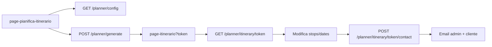

# Documentazione tecnica – Tema OpenComune (Explora)

Piattaforma WordPress per marketing territoriale: catalogo **esperienze**, prenotazioni, pagamenti, dashboard partner/ufficio e **pianificatore itinerari**.  
Namespace codice: prefisso `opencomune_`. REST base: `{site}/wp-json/opencomune/v1/`. Text domain: `opencomune`.

---

## 1. Architettura generale

| Layer | Tecnologie |
|--------|------------|
| CMS | WordPress (tema child-like monolitico in `opencomune/`) |
| Backend | PHP 8+, `$wpdb`, tabelle custom, CPT, tassonomie, `admin-ajax.php`, REST |
| Frontend pubblico | Template PHP + CSS (`public-theme.css`, moduli dedicati) + JS vanilla |
| Dashboard | Pagine WP con shell comune (`inc/dashboard.php`), Bootstrap/DataTables, asset `dashboard-app.css` |
| Mappe | Google Maps API (chiave in impostazioni tema) |
| Anti-spam | Cloudflare Turnstile (`inc/turnstile.php`) |
| Email | SMTP configurabile + HTML wrapper (`inc/email-template.php`) |
| Pagamenti | SumUp / ordini custom (`inc/payment-orders.php`, checkout REST) |

### 1.1 Bootstrap moduli (`functions.php`)

Alla fine di `functions.php` vengono caricati (ordine rilevante per dipendenze):

`partner-admin-cpt`, `import-esperienze-csv`, `translations`, **planner** (`planner-catalog`, `planner`, `planner-requests-admin`, `planner-itinerary-edit`, `planner-routes`, `planner-email`, `dashboard-planner`, `planner-admin`, `planner-catalog-admin`), `dashboard`, `dashboard-esperienze*`, `partner-bookings`, `dashboard-home`, `bulk-translations`, `rest-api-esperienze`, `availability`, moduli form esperienza, pricing, meeting, tickets, booking channel, partner payment/AI, `ai-translate`, `booking-checkout`, `booking-on-request`, `payment-*`, operations log, `email-template`, `phone-prefix`, `turnstile`, `contact-form`, `social-share`, `home-seo`, `social-proof-badge`.

Calendario eventi tour: `functions-calendario.php` (require separato).

---

## 2. Custom post type, tassonomie e ruoli

### 2.1 CPT (registrati in `functions.php`)

| CPT | Slug | Uso |
|-----|------|-----|
| Esperienze | `esperienze` | Schede bookable, wizard partner, API marketing |
| Partner | `partner` | Profilo ente (legacy CPT; utenti ruolo `partner`) |

### 2.2 Tassonomie principali

- `categorie_esperienze` – categorie catalogo (localizzate IT/EN)
- `temi_esperienze`, `inclusioni_esperienze`, `info_prima_prenotazione`
- `specializzazioni` – profilo partner

### 2.3 Ruoli e capability (helper)

| Funzione | Significato |
|----------|-------------|
| `opencomune_user_can_access_dashboard()` | Partner o staff con accesso area riservata |
| `opencomune_user_can_manage_all_esperienze()` | Ufficio: gestione globale esperienze/partner/pianificatore |
| `opencomune_user_is_partner_only()` | Partner senza permessi ufficio |
| `opencomune_user_can_edit_esperienza($post_id)` | Autore o ufficio |
| `opencomune_get_dashboard_url()` | URL dashboard partner (pagina `dashboard-partner`) |

Redirect e guardie: `inc/dashboard.php` (`template_redirect`) – pagine shell, permessi, redirect legacy.

---

## 3. REST API `opencomune/v1`

Prefisso completo: `https://{dominio}/wp-json/opencomune/v1`.

CORS (filtro `rest_pre_serve_request`): `Access-Control-Allow-Origin: *` sulle route `/opencomune/v1/*`.

### 3.1 Autenticazione API esperienze

- Opzione chiave REST (`opencomune_is_rest_api_key_required()`, header `X-OpenComune-API-Key` o query `api_key`).
- Route **esperienze/tassonomie**: `permission_callback` → `opencomune_rest_api_permission_check`.
- Route **planner** e **checkout**: in genere `__return_true` (token itinerario / session checkout come segreto).

OpenAPI: `opencomune_get_openapi_spec()` in `inc/rest-api-esperienze.php` (documentazione integrazione esterna).

### 3.2 Catalogo esperienze (`inc/rest-api-esperienze.php`)

| Metodo | Path | Callback | Parametri principali |
|--------|------|----------|----------------------|
| GET | `/esperienze` | `opencomune_rest_get_esperienze` | `page`, `per_page`, `search`, `categoria`, `author_type`, `date_from`, `date_to`, `lang`, `include_translations` |
| GET | `/esperienze/{id}` | `opencomune_rest_get_esperienza` | `lang`, `include_translations`, `availability_from`, `availability_to` |
| GET | `/categorie-esperienze` | `opencomune_rest_get_categorie_esperienze` | `lang`, `include_translations` |
| GET | `/temi-esperienze` | `opencomune_rest_get_temi_esperienze` | — |
| GET | `/inclusioni-esperienze` | `opencomune_rest_get_inclusioni_esperienze` | — |
| GET | `/info-prima-prenotazione` | `opencomune_rest_get_info_prima_prenotazione` | — |

Payload singola esperienza: `opencomune_format_esperienza_api($post_id, $options)` – titolo/descrizione localizzati, categorie, galleria, pricing, durata, meeting point, disponibilità, partner, recensioni, canale prenotazione, ecc.

### 3.3 Pianificatore – generazione e lettura (`inc/planner.php`)

| Metodo | Path | Descrizione |
|--------|------|-------------|
| GET | `/planner/config` | Città, interessi, categorie, default partenza – `opencomune_planner_get_config_payload()` |
| POST | `/planner/generate` | Body JSON: date, città, categorie, partenza, traveler type, origine → crea riga `oc_planner_trip_request`, restituisce `token` + redirect URL |
| GET | `/planner/itinerary/{token}` | Trip completo per UI (giorni, tappe arricchite, card, polyline) |
| POST | `/planner/itinerary/{token}/contact` | Invio richiesta contatto + email admin/cliente; body: `name`, `email`, `notes`, `acceptTerms`, `turnstileToken` |

Generazione algoritmo: `opencomune_planner_generate_trip()` – candidati da POI catalogo + esperienze pubblicate, ordinamento nearest-neighbor, slot orari giornalieri (fine giornata configurabile in edit module).

### 3.4 Pianificatore – modifica itinerario (`inc/planner-itinerary-edit.php`)

Fine giornata default: **20:00** (`opencomune_planner_itinerary_day_end_hour()`).

| Metodo | Path | Body / query | Effetto |
|--------|------|--------------|---------|
| GET | `/planner/itinerary/{token}/candidates` | `maxDurationMin` (opz.) | POI/esperienze non ancora in trip, filtrati per durata slot |
| POST | `/planner/itinerary/{token}/stops` | `dayIndex`, `insertIndex`, `source` (`poi`\|`esperienza`), `id` | Aggiunge tappa, rischedula orari giorno |
| DELETE | `/planner/itinerary/{token}/stops` | `dayIndex`, `stopIndex` | Rimuove tappa |
| PUT/PATCH | `/planner/itinerary/{token}/stops/reorder` | `dayIndex`, `fromIndex`, `toIndex` | Drag-and-drop ordine |
| PUT/PATCH | `/planner/itinerary/{token}/dates` | `startDate`, `endDate` | Ridimensiona giorni; errori se tappe su giorni eliminati |

Funzioni core: `opencomune_planner_reschedule_day_stops`, `opencomune_planner_insert_candidate_into_day`, `opencomune_planner_save_trip_days`, `opencomune_planner_update_trip_dates`.

Header consigliato lato JS: `X-WP-Nonce` (nonce `wp_rest` localizzato in `opencomunePlannerItinerary`).

### 3.5 Checkout esperienza (`inc/booking-checkout.php`)

| Metodo | Path | Descrizione |
|--------|------|-------------|
| POST | `/checkout/sessions` | Crea sessione checkout (`experience_id`, `event_id`, `date`, `time`, `participants`) |
| GET | `/checkout/sessions/{token}` | Stato sessione + payload |
| PATCH | `/checkout/sessions/{token}` | Aggiorna anagrafica / partecipanti |
| DELETE | `/checkout/sessions/{token}` | Annulla sessione |
| POST | `/checkout/sessions/{token}/confirm` | Conferma → crea prenotazione, eventuale pagamento online |

Tabella: `opencomune_checkout_sessions_table_name()` (prefisso `wp_`).

---

## 4. Endpoint AJAX (`admin-ajax.php`)

Action WordPress `wp_ajax_*` / `wp_ajax_nopriv_*`. Parametro comune: `action=...`, nonce dove previsto.

### 4.1 `functions.php` (selezione)

| Action | Auth | Scopo |
|--------|------|--------|
| `opencomune_crea_tour` | loggato | Salvataggio esperienza da wizard legacy |
| `opencomune_get_post_thumbnail` / `opencomune_get_gallery_images` | loggato | Media dashboard |
| `opencomune_search_comuni` | anche nopriv | Autocomplete comuni |
| `opencomune_elimina_tour` / `sospendi_tour` / `pubblica_tour` | loggato | Stato pubblicazione |
| `opencomune_registra_pagamento` | loggato | Registro pagamento manuale |
| `opencomune_get_categorie_esperienze` | anche nopriv | Liste categorie |
| `opencomune_get_dashboard_stats` | loggato | Statistiche dashboard |
| `opencomune_get_esperienze_dashboard` | loggato | Griglia esperienze (limitata per partner) |
| `opencomune_get/save_esperienza_translations_dashboard` | loggato | Traduzioni EN |
| `opencomune_toggle_esperienza_status` | loggato | Pubblica/bozza |
| `opencomune_add_prenotazione` | anche nopriv | Aggiunta prenotazione legacy |
| `opencomune_submit_partner_registration` | nopriv | Registrazione partner |
| `opencomune_get/update/delete_partner` | loggato | CRUD partner ufficio |
| `opencomune_verify_partner_code` | nopriv | Verifica codice invito |
| `opencomune_delete_esperienza` | loggato | Elimina CPT |
| `opencomune_get_all_tours` / `opencomune_get_partner_tours_map` | mappa | Marker tour |
| `opencomune_search_tour_autocomplete` | pubblico | Ricerca |
| `opencomune_submit_review` | loggato | Recensioni (`review-system.php`) |
| `opencomune_prenota_tour` / `opencomune_processa_pagamento` | pubblico | Flusso prenotazione/pagamento legacy |

### 4.2 Altri moduli

| Action | File | Scopo |
|--------|------|--------|
| `opencomune_planner_admin_datatables` | `planner-admin-datatables.php` | Server-side DataTables admin pianificatore |
| `opencomune_esperienze_categories_datatables` | `dashboard-esperienze-categories.php` | Categorie in dashboard |
| `opencomune_mark_partner_bookings_seen` | `partner-bookings.php` | Badge sidebar |
| `opencomune_get_booking_sidebar_badge_counts` | idem | Conteggi nuove prenotazioni |
| `opencomune_get/save_booking_detail` | idem | Dettaglio prenotazione |
| `opencomune_get_prenotazioni` | idem | Lista prenotazioni |
| `opencomune_refund/cancel/update_booking_status` | idem | Operazioni stato/rimborso |
| `opencomune_preview_availability` | `availability.php` | Anteprima calendario disponibilità |
| `opencomune_respond_booking_request` | `booking-on-request.php` | Approva/rifiuta richiesta on-request |
| `opencomune_get_dashboard_home_performance` | `dashboard-home.php` | KPI home dashboard |
| `opencomune_get_incassi_dashboard` | `payment-revenue.php` | Incassi |
| `opencomune_get_operations_log` | `dashboard-operations.php` | Log operazioni piattaforma |
| `opencomune_ai_translate_esperienza_field` | `ai-translate.php` | Traduzione AI campo |
| `opencomune_add/delete_calendario`, `opencomune_get_calendario` | `functions-calendario.php` | Eventi calendario tour |
| `opencomune_import_csv_preview/confirm` | `import-esperienze-csv.php` | Import CSV esperienze |

---

## 5. Database custom (tabelle principali)

| Tabella | Modulo | Contenuto |
|---------|--------|-----------|
| `{prefix}oc_planner_trip_request` | `planner.php` | Itinerari generati, JSON giorni, contatto, `email_sent_at` |
| `{prefix}oc_planner_city` | `planner-catalog.php` | Città landing wizard |
| `{prefix}oc_planner_interest` | idem | Interessi / categorie wizard |
| `{prefix}oc_planner_focus` | idem | Focus tematici |
| `{prefix}oc_planner_poi` | idem | POI destinazioni mappa |
| `{prefix}tour_prenotazioni` (+ meta) | bookings | Prenotazioni (legacy + nuovo flusso) |
| `{prefix}tour_prenotazioni_log` | `partner-bookings.php` | Audit trail prenotazione |
| `{prefix}tour_ordini` | `payment-orders.php` | Ordini pagamento |
| Sessioni checkout | `booking-checkout.php` | Token sessione checkout |

Payload trip lato API: `opencomune_planner_trip_payload_from_row()` in `planner-requests-admin.php`.

---

## 6. Pianificatore – flusso frontend

### 6.1 Pagine template

| Template | File | Ruolo |
|----------|------|--------|
| Pianifica itinerario | `page-pianifica-itinerario.php` | Landing città, wizard step (`?step=wizard|origin|landing`), `#oc-planner-wizard` |
| Itinerario | `page-itinerario.php` | Shell `#oc-planner-itinerary`, query `?token=` |
| Pianificatore (admin shell) | `page-pianificatore.php` | Redirect/gestione back-office catalogo |

Chrome dedicato: `template-parts/planner-flow-header.php` (Esci → home, filtro `opencomune_planner_exit_url`). Body class `oc-planner-wizard-flow` se `opencomune_planner_use_flow_chrome()`.

### 6.2 Asset JS/CSS

| Asset | Ruolo |
|-------|--------|
| `assets/js/planner-wizard.js` | Wizard configurazione, POST `/planner/generate` |
| `assets/js/planner-itinerary.js` | Vista itinerario: mappa Google, timeline, modali date/aggiungi tappa, drag-drop, pagina contatto, history `?step=contact` |
| `assets/js/planner-alerts.js` | Toast/modali alert (`opencomunePlannerAlert`) |
| `assets/css/planner-public.css` | Layout wizard + itinerary + form contatto |

Oggetto globale: `window.opencomunePlannerItinerary` – `restUrl`, `token`, `nonce`, `turnstileRequired`, `turnstileSiteKey`, `i18n`.

### 6.3 Pagina «Invia percorso»

Render client-side in `planner-itinerary.js`: `renderContactPageHtml`, `bindContactPageForm`.  
POST contact con Turnstile; stati UI: notice successo (verde) al primo invio, notice «già inviato» se `emailSentAt` o 409 `already_sent`.  
Backend: `opencomune_planner_submit_contact()` – claim atomico su `email_sent_at`, email via `opencomune_planner_send_planner_contact_emails()`.

### 6.4 Admin pianificatore

- URL: pagina `dashboard-pianificatore` / `pianificatore` – `opencomune_get_planner_dashboard_url()`.
- Viste: `destinations`, `cities`, `interests`, `focuses`, `requests`, `settings` – query var + template in `template-parts/planner-admin/*`.
- POST actions: `inc/planner-catalog-admin.php` (`opencomune_planner_admin_handle_post`).
- Richieste utente: `inc/planner-requests-admin.php` – modifica contatto, reinvio email cliente, delete trip.
- DataTables AJAX: `opencomune_planner_admin_datatables_callback`.

---

## 7. Esperienze – wizard e disponibilità

### 7.1 Pagine

- `page-nuova-esperienza.php` – wizard multi-step partner/ufficio (`assets/js/esperienza-wizard.js`).
- `single-esperienza.php` – scheda pubblica + prenotazione.
- `archive-esperienze.php` – archivio.

Template parts form: `template-parts/esperienza-form-*` (pricing, tickets, location, calendario, bilingual, itinerary steps, ecc.).

Logica step: `inc/esperienza-form-steps.php`, riepilogo `inc/esperienza-form-summary.php`.

### 7.2 Disponibilità e calendario

- `inc/availability.php` – regole capacità, slot, preview AJAX.
- `functions-calendario.php` – eventi collegati a meta tour (`opencomune_calendario_events_for_tour` usato anche dal planner per slot esperienze).

### 7.3 Itinerary steps (contenuto esperienza)

- PHP: `inc/esperienza-itinerary-steps.php`
- Template: `template-parts/esperienza-itinerary-steps.php`
- JS: `esperienza-itinerary-steps.js`, mappa step `esperienza-itinerary-step-map.js`

---

## 8. Prenotazioni, checkout pagina, on-request

| Componente | File | Note |
|------------|------|------|
| Checkout UI | `page-checkout-esperienza.php` | Consuma REST checkout sessions |
| On-request | `inc/booking-on-request.php` | Richiesta → email → approvazione partner |
| Email transizioni | `inc/email-template.php` | `opencomune_send_booking_request_*` |
| Ticket PDF/HTML | `template-parts/booking-ticket-document-html.php` | Documento prenotazione |
| ICS | `inc/booking-calendar-ics.php` | Export calendario |
| Partner dashboard | `page-prenotazione-partner.php` + `partner-bookings.php` | Gestione stati |

Stati prenotazione: helper `opencomune_booking_status_label()` e transizioni in `partner-bookings.php`.

---

## 9. Pagamenti, commissioni, incassi

- `inc/payment-orders.php` – ordini, integrazione gateway.
- `inc/payment-commissions.php` – regole commissione.
- `inc/payment-revenue.php` – dashboard incassi (`page-incassi.php`).
- `inc/partner-payment-settings.php` – SumUp/settings partner.
- Pagine esito: `page-pagamento-confermato.php`, `page-pagamento-annullato.php`.

---

## 10. Email, contatti, sicurezza

### 10.1 Template HTML

`inc/email-template.php`: `opencomune_wrap_html_email`, `opencomune_send_html_email`, sezioni prenotazione e pagamento.

Pianificatore: `inc/planner-email.php` – notifica admin + itinerario cliente con CTA link public token.

### 10.2 Form contatti sito

`inc/contact-form.php` + `page-contatti.php` – invio messaggio, Turnstile, email HTML.

### 10.3 Turnstile

`opencomune_is_turnstile_configured()`, `opencomune_verify_turnstile_response()`, `opencomune_render_turnstile_widget()`.  
Impostazioni in admin tema (opzioni `opencomune_turnstile_*`). Usato su login, registrazione partner, contatti, invio itinerario planner.

---

## 11. Sito pubblico – template e partial

### 11.1 Template pagina (`page-*.php`)

| Slug / template | Scopo |
|-----------------|--------|
| `front-page.php` | Home, mappa, categorie |
| `page-login.php` | Login + primo accesso |
| `page-registrazione-partner.php` | Wizard registrazione |
| `page-contatti.php` | Form contatti |
| `page-mappa-esperienze.php` | Mappa esperienze |
| `page-checkout-esperienza.php` | Checkout |
| `page-dashboard-partner.php` | Home dashboard |
| `page-esperienze-partner.php` | Lista esperienze |
| `page-profilo-partner.php` | Profilo |
| `page-gestione-partner.php` / `dettaglio-partner` | Ufficio – partner |
| `page-categorie-esperienze.php` | Gestione categorie |
| `page-commissioni.php`, `page-incassi.php`, `page-operazioni.php` | Ufficio finanza/log |
| `page-profilo-partner-ai.php` | Impostazioni AI traduzione |
| `author.php` | Archivio autore/partner |

### 11.2 Partial riutilizzabili

- `template-parts/public-site-header.php` – header sito pubblico.
- `template-parts/home-*` – card home.
- `template-parts/dashboard-sidebar.php` – navigazione dashboard.
- `template-parts/esperienza-card.php`, `partner-card.php`.
- `template-parts/share-buttons.php` – social (`inc/social-share.php`).

### 11.3 Asset frontend pubblico

| CSS | JS | Pagine tipiche |
|-----|-----|----------------|
| `public-theme.css` | `public-header.js` | Tutto il sito pubblico |
| `public-login.css` | `public-login.js` | Login |
| `partner-registration.css` | `partner-registration-wizard.js` | Registrazione |
| `public-contatti.css` | — | Contatti |
| `public-map.css` | `public-map.js`, `home-map.js` | Mappa / home |
| `front-page.css` | — | Home |

---

## 12. Dashboard – shell e script

`inc/dashboard.php`:

- `opencomune_render_dashboard_shell($content_callback)` – layout sidebar + contenuto.
- Enqueue condizionato per pagina: esperienze DataTable, bookings, incassi, planner map/media, ecc.

JS principali in `assets/js/`:

- `dashboard-esperienze-*.js`, `dashboard-bookings*.js`, `dashboard-incassi.js`, `dashboard-planner-*.js`, `dashboard-partner-home.js`, `dashboard-sidebar-booking-badges.js`.

CSS: `assets/css/dashboard-app.css`.

---

## 13. Traduzioni e AI

- `inc/translations.php` – bundle IT/EN esperienze e termini.
- `inc/bulk-translations.php` – operazioni mass batch.
- `inc/ai-translate.php` – traduzione campo via AJAX (settings in `partner-ai-settings.php`).

---

## 14. Routing polylines planner

`inc/planner-routes.php` – richieste a Google Directions/Distance Matrix per polyline giornaliera e tempi di spostamento (`opencomune_planner_route_polyline_for_day`, usato in enrich display).

---

## 15. Recensioni e SEO

- `review-system.php` – rating medio, form recensione AJAX.
- `inc/home-seo.php` – meta home.
- `inc/social-proof-badge.php` + JS/CSS badge social proof.

---

## 16. Convenzioni per sviluppatori

1. **Nuove API REST**: registrare su `rest_api_init`, namespace `opencomune/v1`, documentare in OpenAPI se pubbliche.
2. **Nonce REST**: `wp_create_nonce('wp_rest')` per utenti loggati; route planner pubbliche accettano richieste anonime con token segreto nell’URL.
3. **i18n**: stringhe utente con `__()` / `_e()` dominio `opencomune`; chiavi JS via `wp_localize_script`.
4. **Commit DB**: usare `dbDelta` on `init` o `after_switch_theme` come nei moduli planner/prenotazioni.
5. **Email**: preferire `opencomune_send_html_email()` per layout coerente.

---

## 17. Diagramma flusso pianificatore (sintesi)

---

*Documento generato per il tema OpenComune in `/wp-content/themes/opencomune`.*

---

# Appendice A – Indice funzioni PHP

## inc/ai-translate.php
- `\1`($user_id) {
- `\1`($user_id, array $messages) {
- `\1`($post_id, $field_key, $user_id) {
- `\1`() {

## inc/availability.php
- `\1`() {
- `\1`() {
- `\1`() {
- `\1`($raw) {
- `\1`($post_id) {
- `\1`($post_id, $post_data) {
- `\1`($post_id) {
- `\1`($post_id) {
- `\1`($date_ymd) {
- `\1`($post_id) {
- `\1`($from, $to, $max_days = 120) {
- `\1`(array $rule, $date_ymd) {
- `\1`($post_id, array $rule) {
- `\1`($post_id, $date_ymd, $time_hm) {
- `\1`($post_id, $rule_max) {
- `\1`($tour_id, $date_ymd, $time_hm, $rule_id) {
- `\1`($post_id, $from, $to, $rules_override = null) {
- `\1`($post_id) {
- `\1`() {
- `\1`($time_raw) {
- `\1`($tour_id, array $row) {
- `\1`($tour_id, $date_ymd, $time_hm, $rule_id = '') {
- `\1`($booking) {
- `\1`($booking_id) {
- `\1`($tour_id, $date_ymd, $time_hm, $exclude_booking_id = 0) {
- `\1`($tour_id, $date_ymd, $time_hm, $exclude_booking_id = 0) {
- `\1`($tour_id) {
- `\1`($tour_id, $occurrence_id, $from = null, $to = null) {
- `\1`($tour_id, $from = null, $to = null, $rules_override = null) {
- `\1`($tour_id, $event_id, $participants = 1, array $slot_hint = []) {
- `\1`(array $data) {
- `\1`($tour_id, $event_id, $participants, array $slot) {
- `\1`($tour_id, $event_id, $participants, array $slot = []) {
- `\1`($tour_id, $event_id, $delta, array $slot = []) {
- `\1`($booking) {
- `\1`($booking, $participants, $exclude_booking_id = 0) {
- `\1`($booking) {
- `\1`($booking) {
- `\1`() {
- `\1`($post_id, $form_id = 'modifica-esperienza-form') {
- `\1`($post_id, $from = null, $to = null) {

## inc/booking-calendar-ics.php
- `\1`($booking_id, $ordine = null) {
- `\1`($tour_id) {
- `\1`($value) {
- `\1`(DateTimeInterface $dt) {
- `\1`(array $event) {
- `\1`($booking_id, $ordine = null) {
- `\1`(array $event) {
- `\1`(array $event) {
- `\1`(array $event) {
- `\1`($booking_id, $ordine = null) {

## inc/booking-checkout.php
- `\1`() {
- `\1`() {
- `\1`($token) {
- `\1`($experience_id, array $participants_by_category) {
- `\1`(array $args) {
- `\1`($token) {
- `\1`($token, array $patch) {
- `\1`($token) {
- `\1`($token) {
- `\1`() {
- `\1`(WP_REST_Request $request) {
- `\1`(WP_REST_Request $request) {
- `\1`(WP_REST_Request $request) {
- `\1`(WP_REST_Request $request) {
- `\1`(WP_REST_Request $request) {

## inc/booking-on-request.php
- `\1`($experience_id) {
- `\1`() {
- `\1`($booking_id) {
- `\1`($token, $status, $expires_gmt, array $payload_patch = []) {
- `\1`($token) {
- `\1`($experience_id) {
- `\1`($token) {
- `\1`($booking_id) {
- `\1`($booking_id, $reason) {
- `\1`($booking_id) {
- `\1`($booking_id, $decision, $reason = '') {
- `\1`() {

## inc/bulk-translations.php
- `\1`() {
- `\1`($label) {
- `\1`($overwrite = false) {
- `\1`($text) {
- `\1`($post_id, $overwrite = false) {
- `\1`($args = []) {
- `\1`() {
- `\1`() {

## inc/contact-form.php
- `\1`() {
- `\1`() {
- `\1`() {
- `\1`($values, $page_url = '') {
- `\1`($values) {
- `\1`($values, $page_url = '') {
- `\1`($atts) {

## inc/dashboard-esperienze-categories.php
- `\1`() {
- `\1`() {
- `\1`() {
- `\1`(array $args = []) {
- `\1`() {
- `\1`($term_id) {
- `\1`($term_id) {
- `\1`($term_id) {
- `\1`($term_id, $url) {
- `\1`($type, $message) {
- `\1`() {
- `\1`() {
- `\1`() {
- `\1`() {
- `\1`(array $rows, $search) {
- `\1`(array $rows, $sort_key, $direction) {
- `\1`() {
- `\1`() {
- `\1`() {
- `\1`($with_datatable = true) {

## inc/dashboard-esperienze-query.php
- `\1`($name) {
- `\1`($post_id) {
- `\1`(array $filters) {
- `\1`(array $filters, $offset, $length) {
- `\1`() {
- `\1`() {

## inc/dashboard-esperienze.php
- `\1`() {
- `\1`() {
- `\1`() {

## inc/dashboard-home.php
- `\1`() {
- `\1`(int $days, int $author_id = 0) {
- `\1`() {
- `\1`(int $days, int $author_id = 0) {
- `\1`() {
- `\1`() {
- `\1`(array $card) {

## inc/dashboard-operations.php
- `\1`() {
- `\1`() {
- `\1`() {
- `\1`() {
- `\1`() {

## inc/dashboard-planner.php
- `\1`() {
- `\1`() {
- `\1`() {
- `\1`() {
- `\1`() {
- `\1`($view = 'destinations', $args = []) {
- `\1`() {
- `\1`() {
- `\1`($with_map = false) {

## inc/dashboard.php
- `\1`() {
- `\1`() {
- `\1`() {
- `\1`() {
- `\1`() {
- `\1`() {
- `\1`() {
- `\1`() {
- `\1`() {
- `\1`() {
- `\1`() {
- `\1`() {
- `\1`() {
- `\1`() {
- `\1`() {
- `\1`() {
- `\1`($post_id) {
- `\1`() {

## inc/email-template.php
- `\1`() {
- `\1`() {
- `\1`($title, $body_html, $args = []) {
- `\1`($text) {
- `\1`(array $rows) {
- `\1`($text) {
- `\1`(array $items) {
- `\1`($to, $subject, $body_html, $args = []) {
- `\1`($ordine) {
- `\1`($nome, $cognome, $tour_title, $data, $orario, $prenotazione_id, $metodo_text) {
- `\1`($nome, $cognome, $tour_title, $data, $orario, $prenotazione_id, $email, $telefono, $metodo_text, $note = '') {
- `\1`($booking_id) {
- `\1`($booking_id, $checkout_token = '') {
- `\1`($booking_id, $checkout_token) {
- `\1`($booking_id) {
- `\1`($booking_id, $reason) {

## inc/esperienza-booking-channel.php
- `\1`() {
- `\1`() {
- `\1`($mode) {
- `\1`() {
- `\1`() {
- `\1`($post_id) {
- `\1`($post_id) {
- `\1`($post_id) {
- `\1`($post_id, $checkout_total = null) {
- `\1`($post_id, $post_data) {
- `\1`($post_id) {
- `\1`() {

## inc/esperienza-form-steps.php
- `\1`() {
- `\1`($post_id = 0) {
- `\1`($post_id = 0) {
- `\1`($attachment_id) {
- `\1`($config = []) {

## inc/esperienza-form-summary.php
- `\1`($internal_id) {
- `\1`($post_id) {
- `\1`($post_id) {
- `\1`($post_id) {
- `\1`($post_id) {

## inc/esperienza-gallery-lightbox.php
- `\1`($attachment_id) {
- `\1`(array $attachment_ids) {
- `\1`() {

## inc/esperienza-identification.php
- `\1`() {
- `\1`() {
- `\1`() {
- `\1`() {
- `\1`($term_id) {
- `\1`($user_id = 0) {
- `\1`($user_id = 0) {
- `\1`($user_id = 0) {
- `\1`($term, $user_id = 0) {
- `\1`($taxonomy, $post_id = 0, $user_id = 0) {
- `\1`($taxonomy, $label, $partner_id) {
- `\1`($taxonomy, $label) {
- `\1`($taxonomy, $raw_values, $user_id = 0) {
- `\1`(array $terms, array $selected_values) {
- `\1`($post_id) {
- `\1`($post_id, $taxonomy) {
- `\1`($post_id, $taxonomy, $selected_slugs = []) {
- `\1`($post_id) {
- `\1`($post_id, $post_data) {
- `\1`($post_id) {
- `\1`($post_id, $taxonomy) {
- `\1`($post_id) {
- `\1`($taxonomy) {
- `\1`() {

## inc/esperienza-itinerary-steps.php
- `\1`($raw) {
- `\1`($post_id) {
- `\1`($post_id, $post_data) {
- `\1`() {
- `\1`() {

## inc/esperienza-settings.php
- `\1`() {
- `\1`($type) {
- `\1`($post_id) {
- `\1`($legacy) {
- `\1`($type) {
- `\1`($post_id, $post_data) {
- `\1`() {
- `\1`($post_id) {

## inc/esperienza-tickets.php
- `\1`($post_id) {
- `\1`($post_id, $post_data) {
- `\1`($supplier_name) {
- `\1`(array $config) {
- `\1`($post_id, $time_override = '') {
- `\1`($post_id) {
- `\1`($post_id = 0) {
- `\1`() {
- `\1`($booking_id, $ordine = null) {
- `\1`(array $context) {
- `\1`($booking_id, $ordine = null) {
- `\1`($booking_id, $ordine = null) {
- `\1`($post_id) {

## inc/home-seo.php
- `\1`() {
- `\1`() {
- `\1`() {
- `\1`() {
- `\1`($title) {
- `\1`() {
- `\1`() {
- `\1`() {
- `\1`() {

## inc/import-esperienze-csv.php
- `\1`() {
- `\1`() {
- `\1`() {
- `\1`($hook) {
- `\1`() {
- `\1`() {
- `\1`($value = null) {
- `\1`($value = null) {
- `\1`($value = null) {
- `\1`($publish_after_import) {
- `\1`($data) {
- `\1`($endpoint, $args) {
- `\1`($data) {
- `\1`($photo_reference) {
- `\1`($image_url, $post_id, $title) {
- `\1`($data, $import_google_cover, $duplicate_id = 0) {
- `\1`($post_id, $data) {
- `\1`($header) {
- `\1`() {
- `\1`($name) {
- `\1`($organization) {
- `\1`($organization, $city = '', $latitude = 0.0, $longitude = 0.0) {
- `\1`($organization, $city = '', $latitude = 0.0, $longitude = 0.0, $dry_run = false) {
- `\1`($raw_date) {
- `\1`($value) {
- `\1`($tipologia) {
- `\1`($title, $start_date) {
- `\1`($row, $line_number) {
- `\1`($data, $update_existing) {
- `\1`($data, $options) {
- `\1`($items) {
- `\1`($data, $options) {
- `\1`($file_path) {
- `\1`($file) {
- `\1`($mapped_rows, $options) {
- `\1`($mapped_rows, $options) {
- `\1`($token) {
- `\1`() {
- `\1`($mapped_rows, $options) {
- `\1`() {
- `\1`() {
- `\1`() {

## inc/meeting-pickup.php
- `\1`() {
- `\1`($mode) {
- `\1`($post_id) {
- `\1`($raw) {
- `\1`($post_id) {
- `\1`($post_id) {
- `\1`($post_id, $post_data) {
- `\1`($post_id) {
- `\1`() {
- `\1`() {

## inc/partner-admin-cpt.php
- `\1`() {
- `\1`() {
- `\1`($tour_partner_id) {
- `\1`($status) {
- `\1`($post_status) {
- `\1`() {
- `\1`($callback) {
- `\1`($partner_id) {
- `\1`($post_id, $partner) {
- `\1`($partner_id) {
- `\1`($post_id) {
- `\1`($value) {
- `\1`($user_id) {
- `\1`() {
- `\1`($user_id, $email_login) {
- `\1`($user_id, array $input) {
- `\1`($logo_url, $attachment_id = 0) {
- `\1`($post_id, $logo_url, $attachment_id = 0, $user_id = 0) {
- `\1`($field_id, $label, $type = 'text', $args = []) {
- `\1`() {
- `\1`($post) {
- `\1`() {
- `\1`() {
- `\1`($post) {
- `\1`($post) {
- `\1`($post) {
- `\1`($post) {
- `\1`($post) {
- `\1`($post_id, $post, $update = null) {
- `\1`($hook) {
- `\1`() {
- `\1`($partner_id) {
- `\1`($columns) {
- `\1`($column, $post_id) {
- `\1`($actions, $post) {
- `\1`() {
- `\1`() {

## inc/partner-ai-settings.php
- `\1`() {
- `\1`($user_id) {
- `\1`($user_id, array $input) {
- `\1`($user_id) {
- `\1`() {

## inc/partner-bookings.php
- `\1`() {
- `\1`($booking_id) {
- `\1`($booking_id, $action, $reason, $status_from, $status_to) {
- `\1`($booking_id, $reason) {
- `\1`($status) {
- `\1`($booking_id) {
- `\1`($booking_id) {
- `\1`() {
- `\1`() {
- `\1`() {
- `\1`() {
- `\1`() {
- `\1`() {
- `\1`() {
- `\1`() {
- `\1`($booking_id) {
- `\1`($booking_id, $order = null) {
- `\1`($booking_id, $order = null) {
- `\1`($booking_id) {
- `\1`($booking_id) {
- `\1`($date_raw, $time_raw) {
- `\1`(array $args) {
- `\1`(array $args = []) {
- `\1`(array $args = []) {
- `\1`($order_by, $order_dir) {
- `\1`($column_index, $order_dir, $show_partner) {
- `\1`() {
- `\1`($row) {
- `\1`($booking_id, array $fields) {
- `\1`($booking_id, $new_status) {
- `\1`() {
- `\1`() {
- `\1`() {
- `\1`() {
- `\1`() {
- `\1`() {
- `\1`() {
- `\1`() {

## inc/partner-payment-settings.php
- `\1`() {
- `\1`() {
- `\1`() {
- `\1`() {
- `\1`(array $input) {
- `\1`() {
- `\1`() {
- `\1`() {
- `\1`() {
- `\1`($api_key) {
- `\1`($user_id) {
- `\1`($user_id, array $input) {
- `\1`($experience_id, $gateway = '') {
- `\1`(array $config, $gateway) {

## inc/payment-commissions.php
- `\1`() {
- `\1`() {
- `\1`($percent) {
- `\1`($gross_total, $percent = null) {
- `\1`() {
- `\1`() {
- `\1`($order) {
- `\1`($booking) {
- `\1`($order) {
- `\1`($order) {
- `\1`($limit = 300) {
- `\1`($order) {
- `\1`() {
- `\1`() {

## inc/payment-orders.php
- `\1`() {
- `\1`() {
- `\1`() {
- `\1`($order_id) {
- `\1`($token) {
- `\1`($booking_id) {
- `\1`($experience_id, array $context = []) {
- `\1`($time_value) {
- `\1`($ordine) {
- `\1`($order_id, $checkout_id) {
- `\1`($tour_id, $checkout_id, $checkout_reference = '') {
- `\1`(array $body) {
- `\1`($tour_id, $checkout_id, $checkout_reference = '') {
- `\1`($status) {
- `\1`($status) {
- `\1`($status) {
- `\1`($order_id, $transaction_id) {
- `\1`($order, $tour_id = 0) {
- `\1`($order_id) {
- `\1`($tour_id, $transaction_id, $amount = null) {
- `\1`($order, $booking_status) {
- `\1`($booking_id) {
- `\1`($order, $tour_id = 0, $booking_status = '') {
- `\1`($tour_id, $checkout_id, $checkout_reference = '') {
- `\1`($booking_id) {
- `\1`($checkout_token, $booking_id = 0) {
- `\1`($order_id, $checkout_token = '', $gateway = 'sumup') {
- `\1`($context) {
- `\1`() {
- `\1`() {

## inc/payment-revenue.php
- `\1`() {
- `\1`() {
- `\1`() {
- `\1`($user_id) {
- `\1`(array $args) {
- `\1`(array $completed_rows, array $refund_rows) {
- `\1`(array $args = []) {
- `\1`() {
- `\1`() {
- `\1`() {

## inc/phone-prefix.php
- `\1`() {
- `\1`() {
- `\1`($phone, $stored_prefix = '') {
- `\1`($prefix, $number) {
- `\1`(array $args = []) {

## inc/planner-admin-datatables.php
- `\1`($entity) {
- `\1`($entity) {
- `\1`($entity) {
- `\1`() {
- `\1`() {
- `\1`() {
- `\1`() {
- `\1`() {
- `\1`(array $rows, $search, array $keys) {
- `\1`(array $rows, $sort_key, $direction) {
- `\1`() {
- `\1`() {

## inc/planner-admin-media.php
- `\1`($url_field = 'image', $attachment_field = 'image_attachment_id') {
- `\1`($url) {
- `\1`(array $args) {
- `\1`() {

## inc/planner-admin.php
- `\1`() {
- `\1`() {
- `\1`() {
- `\1`() {

## inc/planner-catalog-admin.php
- `\1`($view = 'destinations', $args = []) {
- `\1`() {
- `\1`() {
- `\1`() {
- `\1`() {
- `\1`() {
- `\1`() {
- `\1`() {
- `\1`() {
- `\1`() {
- `\1`() {
- `\1`() {
- `\1`() {

## inc/planner-catalog.php
- `\1`($text) {
- `\1`() {
- `\1`() {
- `\1`() {
- `\1`() {
- `\1`() {
- `\1`($input) {
- `\1`($active_only = false) {
- `\1`($id) {
- `\1`($city_slug) {
- `\1`($active_only = false) {
- `\1`($id) {
- `\1`($active_only = false) {
- `\1`($id) {
- `\1`($active_only = false) {
- `\1`($id) {
- `\1`() {
- `\1`() {
- `\1`() {
- `\1`() {
- `\1`($city_slug = '', $category_slugs = []) {
- `\1`($city_slug = '', $category_slugs = []) {
- `\1`() {
- `\1`() {
- `\1`() {
- `\1`() {

## inc/planner-email.php
- `\1`(array $trip) {
- `\1`(array $trip) {
- `\1`() {
- `\1`(array $trip) {
- `\1`(array $trip) {
- `\1`(array $trip, array $contact) {
- `\1`(array $trip, array $contact, $custom_message = '') {
- `\1`(array $trip, array $contact, $custom_message = '') {
- `\1`(string $token, array $contact_input) {
- `\1`(array $trip, array $contact) {

## inc/planner-itinerary-edit.php
- `\1`(array $stop) {
- `\1`(array $days) {
- `\1`(array $row) {
- `\1`(array $pool, $source, $id) {
- `\1`(array $row) {
- `\1`(array $item) {
- `\1`() {
- `\1`() {
- `\1`($hhmm) {
- `\1`(array $row, array $days) {
- `\1`($minutes) {
- `\1`(array $days, array $row, $day_index, $insert_index, $sub_index) {
- `\1`(array $stops, array $row) {
- `\1`(array $days, array $row, $day_index) {
- `\1`(string $token, $max_duration_min = null) {
- `\1`(array $item) {
- `\1`(
- `\1`(string $token, array $days) {
- `\1`(string $token, $day_index, $source, $id, $insert_index = null) {
- `\1`(string $token, $day_index, $from_index, $to_index) {
- `\1`(string $token, $day_index, $stop_index) {
- `\1`(array $days, array $dates) {
- `\1`(string $token, $start_date, $end_date) {
- `\1`($token) {
- `\1`() {

## inc/planner-requests-admin.php
- `\1`($id) {
- `\1`($id) {
- `\1`(array $row) {
- `\1`() {
- `\1`() {
- `\1`() {
- `\1`(array $trip) {

## inc/planner-routes.php
- `\1`(array $points) {
- `\1`(array $stops) {
- `\1`(array $stops) {
- `\1`($start_lat, $start_lng, array $stops) {
- `\1`($start_lat, $start_lng, array $stops) {
- `\1`(array $points) {
- `\1`(array $points) {

## inc/planner.php
- `\1`() {
- `\1`() {
- `\1`() {
- `\1`() {
- `\1`($token = '') {
- `\1`() {
- `\1`() {
- `\1`() {
- `\1`() {
- `\1`() {
- `\1`($label) {
- `\1`(array $item) {
- `\1`($lat1, $lng1, $lat2, $lng2) {
- `\1`($from_lat, $from_lng, $to_lat, $to_lng) {
- `\1`($hhmm, $minutes) {
- `\1`($hhmm) {
- `\1`($start, $end) {
- `\1`(array $item) {
- `\1`($city_slug = '', $category_slugs = []) {
- `\1`($start_lat, $start_lng, array $items) {
- `\1`($city_slug) {
- `\1`(array $input) {
- `\1`() {
- `\1`($token) {
- `\1`(array $days, $start_lat = null, $start_lng = null) {
- `\1`($post_id, $date_ymd) {
- `\1`($post_id, $time_hm) {
- `\1`(array $stop, $day_date = '') {
- `\1`() {
- `\1`() {
- `\1`() {
- `\1`($classes) {
- `\1`() {
- `\1`() {

## inc/platform-operations-log.php
- `\1`() {
- `\1`() {
- `\1`() {
- `\1`(array $args) {
- `\1`($order) {
- `\1`($booking_id, $action, $reason, $status_from, $status_to) {
- `\1`($user_login, $user) {
- `\1`() {
- `\1`() {
- `\1`(array $args = []) {
- `\1`(array $rows) {

## inc/pricing-categories.php
- `\1`($internal_id) {
- `\1`($raw) {
- `\1`() {
- `\1`(array $items, $post_id) {
- `\1`(array $category_row, $experience_id = 0) {
- `\1`($post_id) {
- `\1`($post_id, array $items) {
- `\1`($post_id) {
- `\1`() {
- `\1`($post_id) {
- `\1`($post_id, $post_data) {
- `\1`(array $category_row) {
- `\1`($post_id, $category_id) {
- `\1`($post_id) {
- `\1`() {
- `\1`($raw) {
- `\1`($post_id) {
- `\1`($post_id) {
- `\1`($post_id) {
- `\1`($post_id, $price) {
- `\1`($amount, $with_currency = false) {
- `\1`($post_id) {
- `\1`($post_id) {

## inc/rest-api-esperienze.php
- `\1`(WP_REST_Request $request) {
- `\1`($post_id, $primary_key, $legacy_key = '') {
- `\1`($author_id) {
- `\1`($post_id, $options = []) {
- `\1`($value) {
- `\1`(WP_REST_Request $request, $include_content = true) {
- `\1`(WP_REST_Request $request) {
- `\1`(WP_REST_Request $request) {
- `\1`(WP_REST_Request $request) {
- `\1`(WP_REST_Request $request) {
- `\1`(WP_REST_Request $request) {
- `\1`(WP_REST_Request $request) {
- `\1`($taxonomy) {
- `\1`() {
- `\1`() {
- `\1`() {
- `\1`($vars) {
- `\1`() {
- `\1`() {
- `\1`() {
- `\1`() {
- `\1`() {

## inc/seed-esperienza-esempio.php
- `\1`($taxonomy, $name) {
- `\1`($author_id = 0) {

## inc/social-proof-badge.php
- `\1`($limit = 24) {
- `\1`() {
- `\1`() {
- `\1`() {

## inc/social-share.php
- `\1`($text) {
- `\1`($post_id) {
- `\1`() {
- `\1`() {
- `\1`($author_id, $title = '') {
- `\1`($post_id) {
- `\1`() {

## inc/sync-legal-pages-blocks.php
- `\1`(array $attrs): string {
- `\1`(string $html, string $className = ''): string {
- `\1`(int $level, string $anchor, string $text): string {
- `\1`(array $items, bool $ordered = false): string {
- `\1`(string $className): string {
- `\1`(): string {
- `\1`(string $table_html): string {
- `\1`(): string {
- `\1`(): string {
- `\1`(): string {
- `\1`(int $post_id = 659) {
- `\1`(): array {

## inc/translations.php
- `\1`($post_id, $primary_key, $legacy_key = '') {
- `\1`() {
- `\1`($lang) {
- `\1`() {
- `\1`($value, $type) {
- `\1`($field_key) {
- `\1`($post_id, $field_key, $lang = 'en') {
- `\1`($post_id, $field_key) {
- `\1`($post_id) {
- `\1`($post_id) {
- `\1`($post_id, $field_key) {
- `\1`($post_id) {
- `\1`($post_id, $lang) {
- `\1`($post_id) {
- `\1`($post_id) {
- `\1`() {
- `\1`($post_id) {
- `\1`($post_id, $post_data) {
- `\1`($post_id, $lang = 'it') {
- `\1`($term, $lang = 'it') {
- `\1`($term) {
- `\1`($post_id, $field_name) {
- `\1`($post_id, $field_key) {
- `\1`() {
- `\1`($args) {
- `\1`($section_key, $title = '') {
- `\1`() {
- `\1`($post_id = 0) {
- `\1`() {
- `\1`() {
- `\1`($term) {
- `\1`($term_id) {

## inc/turnstile.php
- `\1`() {
- `\1`() {
- `\1`() {
- `\1`() {
- `\1`($token, $remote_ip = '') {
- `\1`() {
- `\1`($wrapper_class = 'opencomune-turnstile') {

## functions.php
- `\1`($phpmailer) {
- `\1`($email) {
- `\1`($name) {
- `\1`() {
- `\1`($to) {
- `\1`() {
- `\1`() {
- `\1`() {
- `\1`($classes) {
- `\1`() {
- `\1`() {
- `\1`() {
- `\1`() {
- `\1`() {
- `\1`() {
- `\1`() {
- `\1`() {
- `\1`() {
- `\1`($hook) {
- `\1`() {
- `\1`() {
- `\1`() {
- `\1`() {
- `\1`() {
- `\1`() {
- `\1`() {
- `\1`() {
- `\1`() {
- `\1`() {
- `\1`() {
- `\1`($user_id, $author_nicename = '') {
- `\1`() {
- `\1`() {
- `\1`($use_block_editor, $post_type) {
- `\1`() {
- `\1`() {
- `\1`() {
- `\1`() {
- `\1`() {
- `\1`() {
- `\1`() {
- `\1`() {
- `\1`($user_id) {
- `\1`($post_id = 0) {
- `\1`($post_id) {
- `\1`($author_id) {
- `\1`() {
- `\1`($post) {
- `\1`($post_id) {
- `\1`() {
- `\1`() {
- `\1`() {
- `\1`($user_id = null) {
- `\1`() {
- `\1`() {
- `\1`($args) {
- `\1`() {
- `\1`() {
- `\1`($args) {
- `\1`() {
- `\1`() {
- `\1`() {
- `\1`($args) {
- `\1`($menu_class) {
- `\1`() {
- `\1`() {
- `\1`() {
- `\1`() {
- `\1`() {
- `\1`() {
- `\1`() {
- `\1`() {
- `\1`() {
- `\1`($user_id) {
- `\1`($user_id) {
- `\1`($email, $nome_referente, $nome_attivita, $code) {
- `\1`($email, $nome_referente, $nome_attivita, $password) {
- `\1`() {
- `\1`($partner_id, array $data) {
- `\1`($address_line) {
- `\1`($login, $password, $code) {
- `\1`() {
- `\1`() {
- `\1`() {
- `\1`($user = null) {
- `\1`($user_login, $user) {
- `\1`() {
- `\1`() {
- `\1`() {
- `\1`() {
- `\1`() {
- `\1`() {
- `\1`() {
- `\1`($query) {
- `\1`($query) {
- `\1`($query) {
- `\1`($query) {
- `\1`($query) {
- `\1`() {
- `\1`($where) {
- `\1`() {
- `\1`() {
- `\1`() {
- `\1`($tour_date_mode, $tour_start_date, $tour_end_date) {
- `\1`($tour_date_mode, $tour_start_date, $tour_end_date) {
- `\1`($post_data = null) {
- `\1`($post_id) {
- `\1`($parts) {
- `\1`($parts, $lang = 'it') {
- `\1`($post_id, $parts) {
- `\1`($post_id) {
- `\1`($post_id) {
- `\1`($post_id) {
- `\1`($post_id) {
- `\1`($post_id) {
- `\1`($value) {
- `\1`($html, $post_id = 0) {
- `\1`($post_id = 0) {
- `\1`($duration) {
- `\1`($difficulty) {
- `\1`($difficulty) {
- `\1`($difficulty) {
- `\1`($attachment_id) {
- `\1`($post_id) {
- `\1`($post_id, $size = 'large') {
- `\1`() {
- `\1`($post_id, $args = []) {
- `\1`($post_id) {
- `\1`($post_id, $raw_ids) {
- `\1`($post_id) {
- `\1`($post_id) {
- `\1`($days = 7) {
- `\1`($today = null) {
- `\1`($post_id) {
- `\1`($post_id) {
- `\1`($post_id, $today = null) {
- `\1`($author_ids, $limit = 8) {
- `\1`($limit = 12) {
- `\1`($post_id) {
- `\1`() {
- `\1`($filter_date) {
- `\1`($query) {
- `\1`() {
- `\1`($term) {
- `\1`() {
- `\1`($post_id, $category_slug = '') {
- `\1`($post_id, $filter_date = '') {
- `\1`($category_slug = '') {
- `\1`($posts, $query) {
- `\1`($args = []) {
- `\1`($post_id, $selected_slugs = []) {
- `\1`($post_id) {
- `\1`($post_id) {
- `\1`($post_id) {
- `\1`($post_id, $selected_slugs = []) {
- `\1`($post_id) {
- `\1`($post_id, $selected_slugs = []) {
- `\1`($post_id) {
- `\1`($post_id) {
- `\1`($post_id, $selected_slugs = []) {
- `\1`($post_id) {
- `\1`($post_id, $post_data) {
- `\1`($post_id) {
- `\1`() {
- `\1`() {
- `\1`($value) {
- `\1`($raw) {
- `\1`($raw) {
- `\1`($post_id) {
- `\1`(array $days) {
- `\1`($post_id, $post_data) {
- `\1`($raw) {
- `\1`($post_id) {
- `\1`($post_id, $post_data) {
- `\1`($hours, $minutes) {
- `\1`($post_id) {
- `\1`() {
- `\1`($value) {
- `\1`($post_id) {
- `\1`($post_id) {
- `\1`($post_id, $post_data) {
- `\1`() {
- `\1`($value) {
- `\1`($post_id) {
- `\1`($post_id, $value) {
- `\1`($post_id) {
- `\1`($terms) {
- `\1`($post_id, $post_data) {
- `\1`($post_id) {
- `\1`($post_id, $selected_slugs = [], $new_category_names = []) {
- `\1`($user_id) {
- `\1`($descrizione_breve) {
- `\1`($partner, $user_id = 0) {
- `\1`($args = []) {
- `\1`() {
- `\1`() {
- `\1`() {
- `\1`($partner_id) {
- `\1`() {
- `\1`() {
- `\1`() {
- `\1`() {
- `\1`() {
- `\1`() {
- `\1`($value, $strip_tags = false) {
- `\1`($post_id) {
- `\1`($post_id) {
- `\1`() {
- `\1`() {
- `\1`() {
- `\1`() {
- `\1`() {
- `\1`() {
- `\1`() {
- `\1`($user_id = null) {
- `\1`() {
- `\1`($post_id, $query, $post = null) {
- `\1`() {
- `\1`() {
- `\1`() {
- `\1`($post_id, $post_data) {
- `\1`($user_id) {
- `\1`($post_id, $images) {
- `\1`() {
- `\1`() {
- `\1`($order_id, $totale, $nome, $email, $tour_id = 0) {
- `\1`($order_id, $totale, $nome, $email, $tour_id = 0) {
- `\1`() {
- `\1`($order_id, $totale, $nome, $email, $tour_id = 0, array $context = []) {
- `\1`() {
- `\1`() {
- `\1`() {
- `\1`() {
- `\1`() {
- `\1`() {
- `\1`() {
- `\1`() {
- `\1`($template) {
- `\1`() {
- `\1`() {

## functions-calendario.php
- `\1`() {

## review-system.php (root tema)
- `\1`($post_id) {
- `\1`($post_id) {
- `\1`($post_id) {
- `\1`($post_id) {
- `\1`($limit = 8) {
